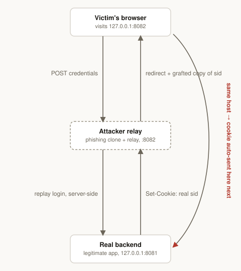
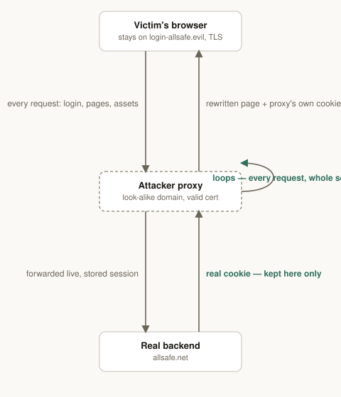

# Allsafe AiTM Awareness Lab

An educational, local-only demonstration of an **Adversary-in-the-Middle (AiTM) credential relay**, built for red-teaming / security-awareness lectures. The fictional company is inspired by *Mr. Robot*. Allsafe names and imagery are third-party references, not official assets or licensed by the project.

> **For isolated classroom use only.** This lab contains a working credential-relay proxy. Do not point it at anything other than its own bundled demo app, do not expose it beyond `127.0.0.1`, and do not reuse any part of it against a real login page or real users.

## What it demonstrates

1. A student (playing "the victim") is told the one demo account that exists in this lab (`DEMO_EMAIL` / `DEMO_PASSWORD`).
2. They open the **phishing** page (`http://127.0.0.1:8082`) — a pixel clone of the real login page — and type those credentials in.
3. The clone's `relay` service replays those exact credentials against the **real** app's real `/login` endpoint, over a Docker network the victim never sees.
4. The real app authenticates the relay as if it were a normal browser and issues a real session cookie.
5. The relay **exfiltrates** that cookie — persists it to the `loot_data` volume and logs it in full — before grafting the same cookie onto the victim's own browser and redirecting it straight to `http://127.0.0.1:8081/workspace`. The victim lands on the **real, legitimate workspace, already logged in**, having never actually talked to it directly; meanwhile the attacker already has a standing copy of that same session.
6. `scripts/monitor.py` surfaces the stolen token live, in a Rich table, the moment it's captured — ready to copy into the follow-up lesson.

The credentials are relayed as typed, not hard-coded — this is what a real AiTM phishing kit (e.g. Evilginx-style) does to bypass "just check the URL" advice and even static-password MFA.

**Be explicit with the class about this: step 5 is a trick, not a reverse proxy.** It only works because both sites share the same host (`127.0.0.1`) — browsers scope cookies by domain, **not** by port, so a cookie set while visiting port `8082` is also sent to port `8081`. A real AiTM kit cannot do this: on two different domains, a cookie issued by the real site is simply invisible to the phishing domain, by design — there is no way to "graft" it into the victim's browser across domains. What a real kit does instead is run a **transparent reverse proxy**: the victim's browser never leaves the attacker's domain, every request (not just the login) is proxied live to the real backend and the response rewritten on the way back, and the stolen cookie is used by the attacker server-side, never by the victim's own browser. This lab's `relay` only proxies a single exchange (`POST /login`) and then hands the victim off with a copied cookie — a shortcut that only exists because of the shared-host quirk, not something you'd see against a real target. See [What a production AiTM kit adds](#what-a-production-aitm-kit-adds-and-why-this-lab-stops-short) below for the full comparison.

## Architecture

- **`legitimate/`** — Real Flask login, server-side PostgreSQL session records, Nginx reverse proxy and a protected workspace. Login, workspace and logout are real routes of the same corporate service, with CSRF-protected forms and `httponly`/`SameSite=Strict` session cookies.
- **`phishing/`** — A static visual clone of the login page, served by Nginx, plus a `relay` service that performs the actual credential relay described above.
- **`scripts/`** — Central CLI start/stop/reset and a read-only Rich monitor that tails both the legitimate app's auth events and the relay's capture/relay events side by side.

**Network isolation:**
- `legitimate/` and `phishing/` each still define their own `internal: true` Docker network for their own containers (database, app, nginx) — fully isolated from the host's internet. Each stack also has a small, non-internal `*_front` network used only by its Nginx container, purely so the host-published port works (an `internal: true` network has no NAT route in either direction, including inbound from the host) — app and db never touch it.
- A single additional network, `aitm-relay-net` (also `internal: true`, so it never reaches the host's internet either), is shared between the two stacks. It is the **only** path between them: just `legitimate`'s Nginx container (reachable as `legitimate-gateway`) and `phishing`'s `relay` container attach to it. This is the "wire" the AiTM relay runs over, kept deliberately visible and minimal for teaching.
- Host ports bind to `127.0.0.1` only.

## Running it

```bash
cp .env.example .env        # first run only
scripts/start.sh            # brings up both stacks + the shared relay network
scripts/monitor.py          # optional: live event timeline for the class
```

- Real app: `http://127.0.0.1:8081` (log in with the demo account directly, to show the "normal" flow first)
- Phishing clone: `http://127.0.0.1:8082` (log in here to show the relay)

```bash
scripts/stop.sh [legitimate | phishing | all]
scripts/reset.sh            # wipes the legitimate DB/sessions and restarts it
```

Sessions expire after `SESSION_TTL_MINUTES` (45 by default). If a demo run sits too long before you get to the Burp follow-up, the stolen token will have expired server-side — just submit the demo credentials on the phishing clone again to mint a fresh one.

## What a production AiTM kit adds (and why this lab stops short)

<p align="center">
  
</p>

This lab's relay only covers a single login exchange, then hands the victim off with a *copy* of the real cookie. The curved red edge above — the victim's browser talking straight to the real backend — only exists because both sites share `127.0.0.1`. On a real target's separate domain, that edge is structurally impossible: a cookie scoped to one domain is never sent to another.

<p align="center">
  
</p>

A real kit instead runs a **persistent, transparent proxy**: there is no edge from the victim's browser to the real backend at all — every request loops through the attacker's proxy for the whole session, and the real cookie never leaves it.

| | This lab | A real AiTM kit (Evilginx / Modlishka / EvilProxy) |
|---|---|---|
| **Scope of the relay** | A single exchange: only `POST /login` is relayed; everything after is the victim talking directly to whichever host it got redirected to. | A persistent, transparent reverse proxy: *every* request of the session — pages, static assets, AJAX — is proxied live and rewritten, for as long as the session lasts. |
| **How the victim gets a "logged-in" page** | The relay copies the real cookie and sets it directly on the victim's own browser. | Never done, because it's not possible across domains — instead the victim keeps talking to the attacker's proxy, which fetches and relays the real pages behind the scenes. The victim's browser never holds the real cookie at all. |
| **Why it "works" here** | A quirk of this lab only: phishing and real app share the same host (`127.0.0.1`), and cookies are scoped by domain, not by port. | Not applicable — real targets are on different domains, so this quirk doesn't exist there. |
| **Domain & TLS** | None — both apps live on `127.0.0.1` at different ports. | A look-alike domain the attacker controls, with a valid TLS certificate, so the victim's browser shows no warning. |
| **MFA** | Not modeled — the lab has one demo account with a single password factor. | The same relay-in-real-time trick intercepts and replays an OTP/push approval before it expires — this is the main reason AiTM kits are dangerous against MFA-protected accounts. |
| **Evasion** | None. | IP reputation checks, bot/sandbox fingerprinting, blocklists — to avoid being analyzed or auto-detected. |
| **What's genuinely the same** | Credentials are relayed live (not stored for later reuse), and a real session cookie is stolen server-side and is independently replayable (see the Burp section below) — that's the actual core AiTM mechanic, demonstrated honestly. | Same mechanic, at the scale and durability of a real attack. |

This lab deliberately stops at the credential-relay + session-theft core and does not implement the reverse proxy, domain/TLS, MFA relay, or evasion layers — those are what turn a teaching demo into a deployable attack tool, and are out of scope for an isolated classroom lab.

## Follow-up lesson: replaying the stolen token in Burp Suite

Every successful relay persists the exfiltrated cookies to a named Docker volume (`loot_data`), independent of the live demo's terminal session, so you can come back to it in the next lesson:

```bash
scripts/loot.sh             # dumps every captured session as JSON
```

Each record has a `replay_header` (the literal `Cookie:` header value) and a `replay_url` (the real app's `/workspace`). Use the **most recent** record — sessions expire after `SESSION_TTL_MINUTES` (45 by default), so a token captured too long before the Burp lesson will already be dead server-side; if so, just submit the demo credentials on the phishing clone again right before the lesson to mint a fresh one. In Burp Suite:

1. Send a `GET /workspace` request to `http://127.0.0.1:8081` to Repeater.
2. Replace its `Cookie` header with the captured `replay_header` value.
3. Send it — no credentials, no login step, just the stolen `sid` — and get back the real, authenticated workspace. That's the session hijack, made visible.
